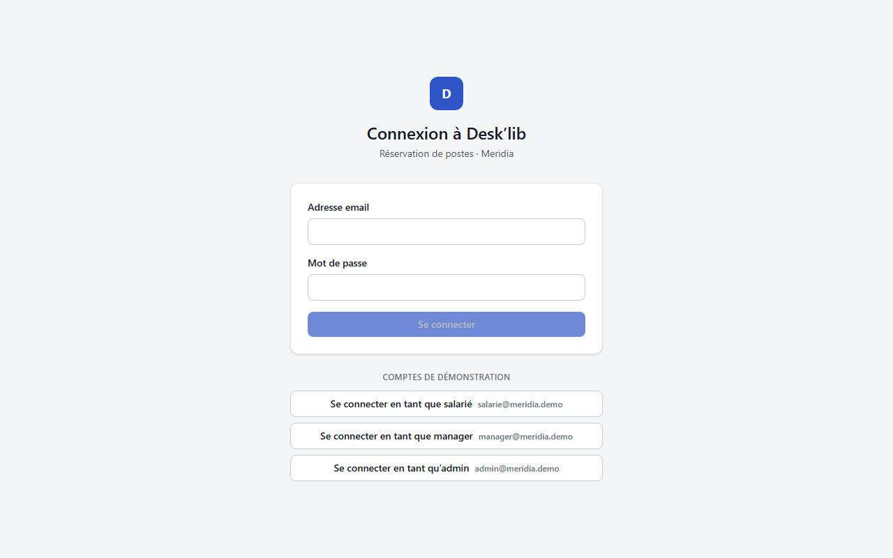
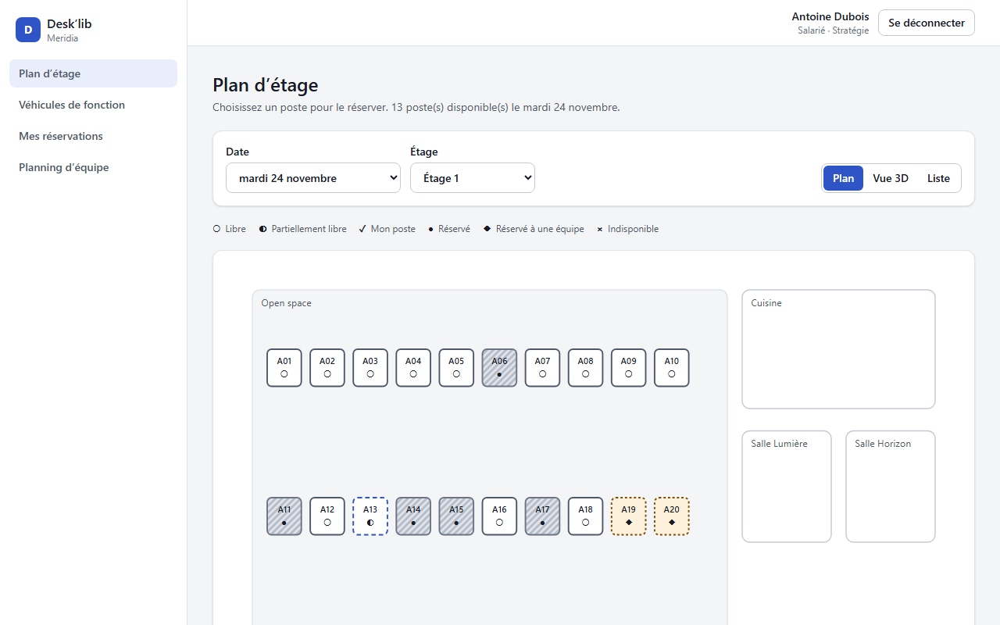
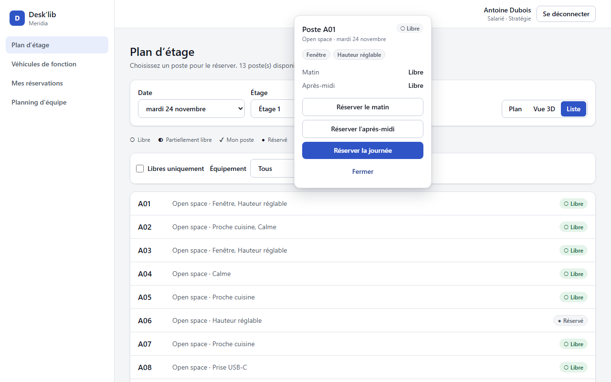
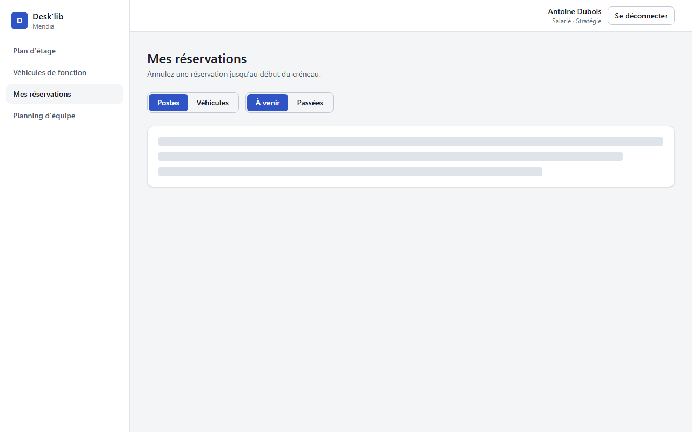
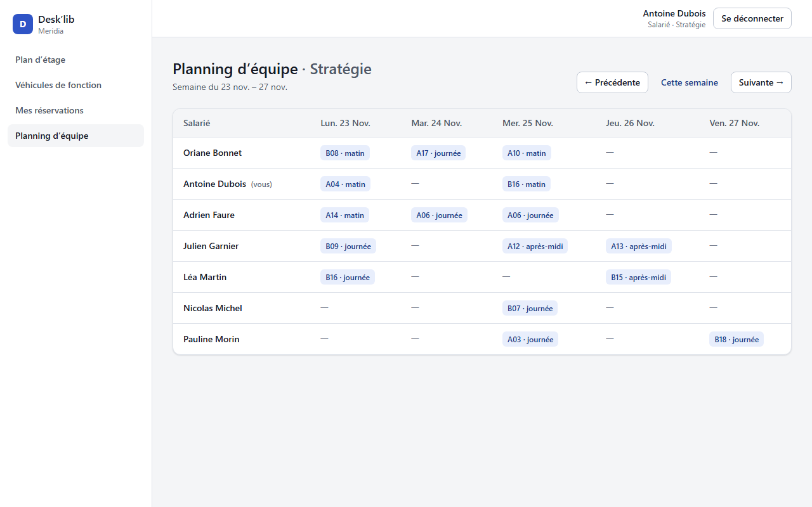
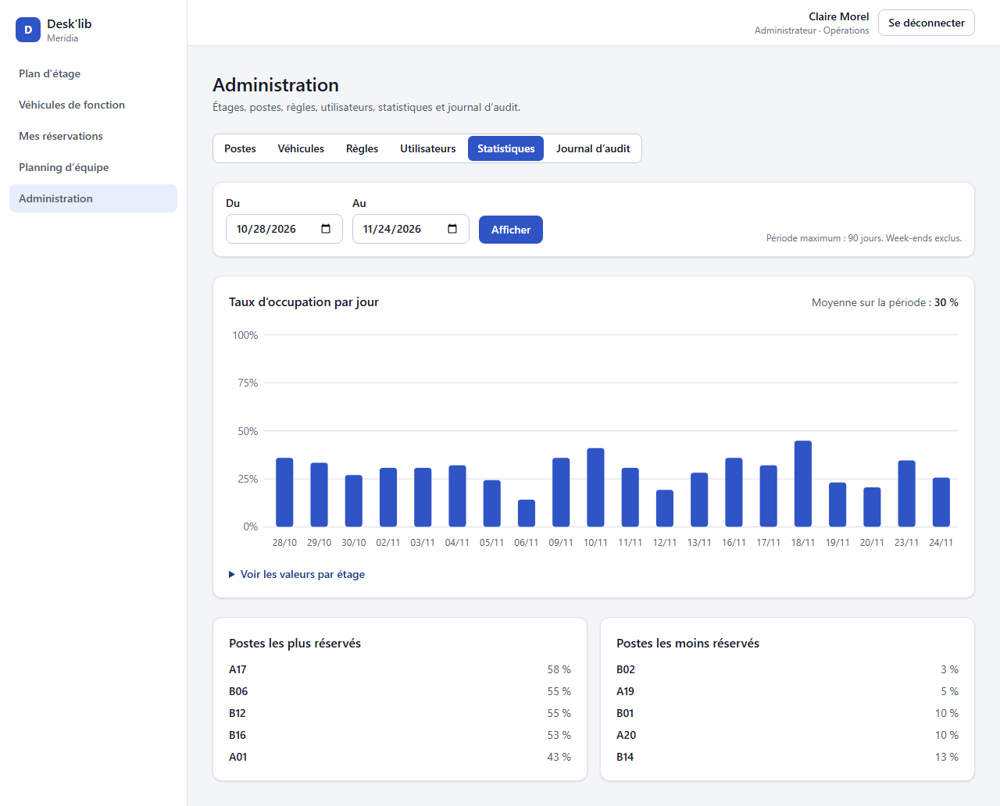

# Desk’lib

Outil interne de réservation de postes en flex office, pour l'entreprise fictive **Meridia** (cabinet de conseil, environ 80 salariés, 2 étages). Projet portfolio : Angular, NestJS, Prisma.

## Démarrer

Prérequis : Node 22.22.3+ et Docker.

```bash
cp .env.example .env        # puis remplacer JWT_SECRET
npm install
npm run db:up               # PostgreSQL local
npm run db:migrate          # applique le schéma
npm run db:seed             # données de démo
npm run dev                 # front http://localhost:4200, API http://localhost:3000
```

## Comptes de démonstration

Mot de passe commun : `demo1234`

| Rôle | Email |
|---|---|
| Salarié | `salarie@meridia.demo` |
| Manager | `manager@meridia.demo` |
| Admin | `admin@meridia.demo` |

## Fonctionnalités

- Plan d'étage généré en SVG, avec popover de réservation (clic ou Entrée).
- Vue 3D : scène WebGL (Three.js) avec du mobilier 3D libre de droits (Kenney, CC0, voir `apps/web/public/3d/LICENSES.md`). Les postes restent cliquables et reflètent leur état. La bibliothèque est chargée seulement à l'ouverture de cette vue.- Vue liste avec filtres (libres, équipement, zone), par défaut sur mobile.
- Réservation matin, après-midi ou journée, dans la limite de 14 jours et les jours ouvrés.
- Quota de 3 jours sur site par semaine ISO.
- Mes réservations : à venir et passées, annulation avec confirmation.
- Planning d'équipe par semaine, taux de présence pour le manager, réservation pour un membre de son équipe.
- Véhicules de fonction : réservation par matin, après-midi ou journée, mêmes règles de dates que les postes. Deux véhicules de démo, que l'administrateur peut ajouter ou désactiver.

Administration (rôle ADMIN) : postes, règles de réservation, utilisateurs et rôles, statistiques d'occupation, journal d'audit paginé.

## Sécurité

Choix faits pour ce projet :

- **Mots de passe** hashés avec argon2. Le hash n'apparaît dans aucune réponse.
- **Session** : JWT dans un cookie `httpOnly`, `SameSite=Strict`, `Secure` en production. Rien dans le `localStorage`.
- **Même site** : le front et l'API sont servis sur la même origine (proxy `/api` en dev, rewrite en prod), ce qui garde le cookie same-site.
- **CSRF** : `SameSite=Strict`, plus une vérification de l'en-tête `Origin` sur les écritures.
- **RBAC côté API** : garde globale d'authentification et décorateur `@Roles`. Les gardes Angular ne servent qu'à l'expérience utilisateur.
- **Propriété** : on n'annule que ses propres réservations, sauf manager de l'équipe ou admin.
- **Anti brute force** : 10 tentatives de connexion par minute et par IP (`@nestjs/throttler`).
- **En-têtes** : helmet. **CORS** limité à l'origine du front.
- **Validation** : `ValidationPipe` avec `whitelist` et `forbidNonWhitelisted`.
- **Double réservation** : impossible au niveau de la base (contraintes uniques), même avec des requêtes simultanées.
- **Traçabilité** : chaque réservation et annulation écrit une ligne dans `AuditLog`, dans la même transaction.

## Structure

```
apps/web        Angular 22 (front)
apps/api        NestJS + Prisma (API)
packages/shared Types et enums communs
```

## Tests

```bash
npm test        # règles métier de l'API, tests du front
npm run e2e     # parcours complet dans un vrai navigateur (Playwright)
npm run ci      # enchaîne lint, tests, build et e2e comme la CI
```

La CI (GitHub Actions, `.github/workflows/ci.yml`) lance les mêmes étapes sur une base PostgreSQL neuve, avec migrations et seed.

## Aperçu













Régénérer les captures : `npm run screenshots`.
